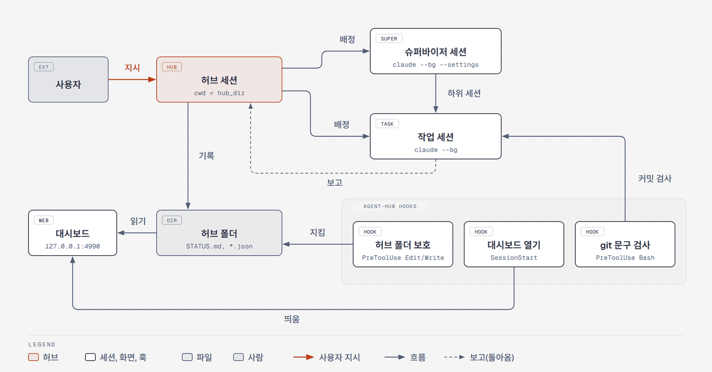
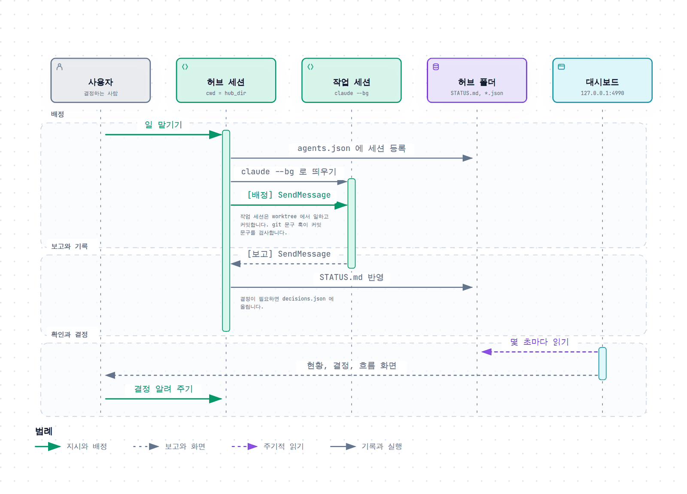
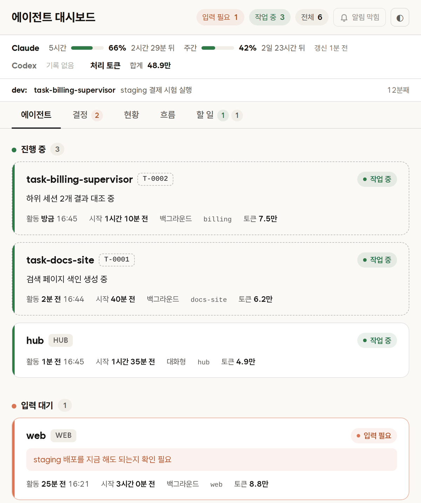
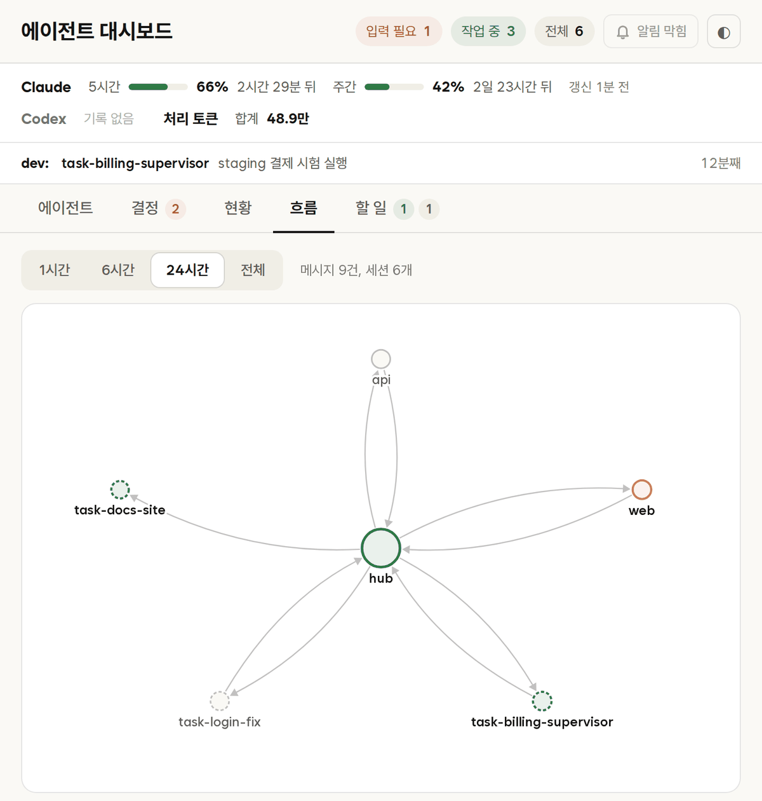

# agent-hub

Claude Code 세션 하나를 허브로 두고, 허브가 다른 세션들에 일을 나눠 맡기고 보고를 받아 기록하게 만드는 플러그인입니다. 허브가 따를 규칙 문서 틀과 세션 현황을 보는 로컬 대시보드, 허브 폴더를 지키는 훅이 함께 들어 있습니다.

<picture>
  <source media="(prefers-color-scheme: dark)" srcset="docs/images/architecture-dark.png">
  
</picture>

## 무엇이 들어 있나

| 구성 | 위치 | 하는 일 |
|---|---|---|
| 허브 규칙 틀 | `templates/hub/` | 허브의 역할(`CLAUDE.md`), 세션 사이 약속(`COORDINATION.md`), 현황판(`STATUS.md`)과 빈 데이터 파일 셋 |
| 대시보드 | `dashboard/` | 떠 있는 세션, 사용자 결정, 현황, 세션 사이 메시지를 보여 주는 읽기 전용 웹 화면. Python 표준 라이브러리만 씁니다 |
| 훅 | `hooks/` | 허브 폴더에서 세션을 열면 대시보드를 띄우고, 다른 세션이 허브 폴더를 고치지 못하게 막고, git 커밋 문구를 검사합니다 |
| 스킬 | `skills/` | 글을 사람이 쓴 것처럼 다듬는 `humanizer`, 커밋 문구 규칙 `git-message` |
| 설정 예시 | `examples/` | 허브와 슈퍼바이저 세션의 권한, 기본 모델 같은 설정 견본 |

## 배정에서 보고까지

사용자는 허브에게만 말합니다. 허브는 작업 세션을 띄워 `[배정]` 메시지를 보내고, 작업 세션은 일을 마치면 `[보고]` 를 보냅니다. 허브가 그 결과를 `STATUS.md` 에 적고 사용자 결정이 필요한 것은 `decisions.json` 에 모으면, 사용자는 대시보드에서 한 번에 확인합니다.

<picture>
  <source media="(prefers-color-scheme: dark)" srcset="docs/images/flow-dark.png">
  
</picture>

## 빠른 시작

Linux 나 macOS 에서 홈 폴더에 받고, `~/hub` 를 허브 폴더로 쓰는 예입니다. Windows 는 아래 [설치](#설치) 절을 보세요.

```sh
cd ~
git clone https://github.com/holiday0726/claude-hub-plugin.git
claude plugin marketplace add ~/claude-hub-plugin
claude plugin install agent-hub@agent-hub --config python=python3 --config hub_dir="$HOME/hub"

mkdir -p ~/hub && cp ~/claude-hub-plugin/templates/hub/* ~/hub/
cd ~/hub && claude
```

세션이 열리면서 `대시보드 http://127.0.0.1:4990 떠 있음` 이 보이면 브라우저로 그 주소를 엽니다.

## 설치

Claude Code, git, Python 3.8 이상이 필요합니다. 저장소 폴더가 그대로 로컬 마켓플레이스라서 받은 폴더를 마켓플레이스로 붙이고 그 안의 `agent-hub` 플러그인을 설치합니다.

### Windows

훅은 셸을 거치지 않고 설정값 `python` 을 그대로 실행합니다. 그래서 Windows 에서는 `python.exe` 의 절대 경로를 넣습니다. PowerShell 에서 경로를 확인합니다.

```powershell
py -3 -c "import sys; print(sys.executable)"
# py 런처가 없으면: python -c "import sys; print(sys.executable)"
```

출력된 경로의 역슬래시를 `/` 로 바꿔 설치에 씁니다. 경로에 빈칸이 있으면 `"python=C:/Program Files/Python312/python.exe"` 처럼 따옴표로 묶습니다.

```powershell
cd $HOME
git clone https://github.com/holiday0726/claude-hub-plugin.git
claude plugin marketplace add C:/Users/<나>/claude-hub-plugin
claude plugin install agent-hub@agent-hub `
  --config python=C:/Users/<나>/AppData/Local/Programs/Python/Python312/python.exe `
  --config hub_dir=C:/Users/<나>/hub
```

Claude Code 세션 안에서 설치해도 됩니다. `/plugin marketplace add C:/Users/<나>/claude-hub-plugin`, `/plugin install agent-hub@agent-hub` 를 차례로 입력한 뒤 `/plugin configure agent-hub@agent-hub` 창에서 `python` 과 `hub_dir` 를 채웁니다.

### Linux, macOS

```sh
git clone https://github.com/holiday0726/claude-hub-plugin.git ~/claude-hub-plugin
claude plugin marketplace add ~/claude-hub-plugin
claude plugin install agent-hub@agent-hub --config python=python3 --config hub_dir="$HOME/hub"
```

### 설치 확인과 갱신

```sh
claude plugin details agent-hub@agent-hub    # Skills (2), Hooks (2) 가 보이면 설치된 것
```

플러그인은 받은 폴더를 그대로 읽습니다. 설치한 뒤에는 그 폴더를 옮기거나 지우지 마세요. 새 판을 받을 때는 그 폴더에서 `git pull` 한 뒤 세션을 다시 열거나 세션 안에서 `/reload-plugins` 를 입력합니다.

인터넷이 안 되는 PC 라면 다른 곳에서 묶어 옮깁니다.

```sh
cd claude-hub-plugin
git bundle create ../agent-hub.bundle HEAD main      # 받는 쪽: git clone agent-hub.bundle claude-hub-plugin
git archive --format=zip -o ../agent-hub.zip main    # 받는 쪽: 압축을 풀기만 하면 됨
```

### 설정값

설치할 때 `--config 키=값` 으로 주고, 나중에는 `claude plugin configure agent-hub@agent-hub` 나 세션 안 `/plugin configure agent-hub@agent-hub` 로 바꿉니다.

| 키 | 필수 | 뜻 | 기본값 |
|---|---|---|---|
| `python` | 예 | 훅을 돌릴 Python 3 명령. Linux 와 macOS 는 `python3`, Windows 는 `python.exe` 절대 경로 | 없음 |
| `hub_dir` | 예 | 허브 폴더의 절대 경로. Windows 는 `C:/Users/<나>/hub` 처럼 `/` 로 씁니다 | 없음 |
| `dashboard_port` | 아니오 | 대시보드 포트. 주소는 늘 `127.0.0.1` 입니다 | `4990` |
| `orca` | 아니오 | 허브 세션을 열 때 Orca 브라우저 탭으로 대시보드를 열지 | 켬(`orca` 명령이 있을 때만) |

## 허브 폴더 만들기

허브 폴더는 허브 세션을 여는 폴더이고, 설정값 `hub_dir` 와 같은 경로여야 합니다. 규칙 틀과 설정 예시를 복사합니다.

Linux, macOS:

```sh
mkdir -p ~/hub/.claude
cp ~/claude-hub-plugin/templates/hub/* ~/hub/
cp ~/claude-hub-plugin/examples/hub.settings.json ~/hub/.claude/settings.json
cp ~/claude-hub-plugin/examples/supervisor.settings.json ~/hub/supervisor.settings.json
```

Windows PowerShell:

```powershell
$hub = "C:\Users\<나>\hub"; $src = "C:\Users\<나>\claude-hub-plugin"
New-Item -ItemType Directory -Force "$hub\.claude" | Out-Null
Copy-Item "$src\templates\hub\*" $hub
Copy-Item "$src\examples\hub.settings.json" "$hub\.claude\settings.json"
Copy-Item "$src\examples\supervisor.settings.json" "$hub\supervisor.settings.json"
```

복사한 뒤 프로젝트에 맞게 채웁니다. 권한과 기본 모델은 플러그인이 넣어 줄 수 없어서 이렇게 예시 파일로 둡니다.

1. `.claude/settings.json`: 허브 세션의 모델과 권한입니다. `deny` 의 `<레인 저장소>` 자리에 허브가 직접 고치면 안 되는 저장소를, `additionalDirectories` 에 그 저장소들의 상위 폴더를 넣습니다.
2. `supervisor.settings.json`: 허브가 슈퍼바이저 세션을 띄울 때 `--settings` 로 붙이는 파일입니다. 슈퍼바이저에게 허락할 일을 `autoMode.allow` 에 문장으로 적습니다.
3. 사용자 설정(`~/.claude/settings.json`, Windows 는 `%USERPROFILE%\.claude\settings.json`)에 `examples/user.settings.json` 의 두 키를 손으로 합칩니다. `crossSessionInbound: "accept"` 가 있어야 세션 사이 메시지가 승인 대기 없이 바로 전달됩니다.
4. `agents.json` 의 `resident.hub.cwd` 에 허브 폴더 경로를 넣고, 허브 세션 안에서 `/rename hub` 로 이름을 맞춥니다. 대시보드는 이 파일에서 `lane` 이 `HUB` 인 세션을 허브로 봅니다.
5. `CLAUDE.md` 와 `COORDINATION.md` 의 `<...>` 자리에 레인, 저장소, 인터페이스를 적습니다.

## 대시보드

허브 폴더의 `agents.json`, `decisions.json`, `STATUS.md`, `dev-occupancy.json` 과 `~/.claude` 아래 세션 기록을 몇 초마다 읽어 보여 줍니다. 읽기만 하고, 세션에 입력을 보내거나 멈추지 않습니다.

<picture>
  <source media="(prefers-color-scheme: dark)" srcset="docs/images/dashboard-dark.png">
  
</picture>
<picture>
  <source media="(prefers-color-scheme: dark)" srcset="docs/images/dashboard-flow-dark.png">
  
</picture>

화면의 세션과 데이터는 설명용 견본입니다.

| 탭 | 보여 주는 것 |
|---|---|
| 에이전트 | 세션을 진행 중, 입력 대기, 종료로 나눈 카드. 누르면 대화 기록과 `claude logs` 화면 |
| 결정 | `decisions.json` 의 결정 항목과 지금 사용자 입력을 기다리는 세션 |
| 현황 | `STATUS.md` |
| 흐름 | 세션 사이 `SendMessage` 를 그래프와 목록으로. `[배정]`, `[보고]`, `[알림]` 머리말로 종류를 나눕니다 |
| 할 일 | 세션별 할 일 목록 |

허브 폴더에서 세션을 열면 훅이 대시보드를 띄워 주므로 따로 실행할 일은 없습니다. 손으로 띄울 때는 허브 폴더와 포트를 환경변수로 줍니다.

```sh
HUB_DIR=~/hub PORT=4990 python3 ~/claude-hub-plugin/dashboard/server.py
```

```powershell
$env:HUB_DIR = "C:\Users\<나>\hub"; $env:PORT = "4990"; py -3 C:\Users\<나>\claude-hub-plugin\dashboard\server.py
```

훅이 띄운 서버의 로그는 `~/.claude/plugins/data/agent-hub-agent-hub/dashboard-<포트>.log` 에 남고, 첫 줄에 서버 pid 가 있습니다. 끌 때는 그 pid 로 `kill <pid>`(Windows 는 `Stop-Process -Id <pid>`)를 실행합니다. 화면 하나하나의 설명은 [dashboard/README.md](dashboard/README.md) 에 있습니다.

## 훅

`hooks/hooks.json` 은 셸을 거치지 않는 형식이라 Windows 에서 Git Bash 를 쓰든 PowerShell 을 쓰든 똑같이 돕니다. 훅 스크립트는 모두 Python 입니다.

| 훅 | 언제 | 하는 일 |
|---|---|---|
| 대시보드 열기 (`open_dashboard.py`) | 세션 시작(SessionStart) | 프로젝트 폴더가 `hub_dir` 이거나 그 아래일 때만 동작합니다. 대시보드가 꺼져 있으면 띄우고, `orca` 가 켜져 있으면 Orca 탭으로 엽니다 |
| 허브 폴더 보호 (`hub_only_write.py`) | Edit, Write, NotebookEdit 직전 | 허브 폴더 밖에서 연 세션이 허브 폴더의 파일을 고치려 하면 막고, 허브에 보고하라고 알립니다. Windows 경로는 대소문자와 역슬래시, `/c/` 꼴을 같은 경로로 봅니다 |
| git 문구 검사 (`git-message-style.py`) | Bash, PowerShell 명령 직전 | `git commit`, `merge`, `tag`, `revert` 와 `gh pr create`, `edit` 문구가 개조식 규칙을 어기면 막습니다. 잠시 끄려면 환경변수 `CLAUDE_GIT_STYLE=off` |

## 스킬

| 스킬 | 부르는 법 | 쓰임 |
|---|---|---|
| humanizer | `/agent-hub:humanizer` | AI 가 쓴 티가 나는 문장을 고칩니다. 허브의 `STATUS.md` 와 결정 문구를 다듬을 때 씁니다 |
| git-message | `/agent-hub:git-message` | 커밋, 머지, PR 문구를 개조식으로 쓰는 규칙. git 문구 검사 훅이 막았을 때 같이 봅니다 |

## 저장소 구조

```
.claude-plugin/   plugin.json, marketplace.json
dashboard/        server.py, index.html, test_server.py, vendor/
docs/             README 그림(images/)과 그림 원본(diagrams/)
examples/         hub.settings.json, supervisor.settings.json, user.settings.json
hooks/            hooks.json, open_dashboard.py, hub_only_write.py, git-message-style.py, hubpath.py
skills/           humanizer/, git-message/
templates/hub/    CLAUDE.md, COORDINATION.md, STATUS.md, agents.json, decisions.json, dev-occupancy.json
tests/            훅 시험
```

## 시험 돌리기

```sh
python3 dashboard/test_server.py        # 대시보드 서버
python3 tests/test_hub_only_write.py    # 허브 폴더 보호, Windows 경로 꼴 포함
python3 tests/test_style_basic.py       # git 문구 기본 규칙
python3 tests/test_style_multi.py       # 한 명령에 git 명령이 여럿일 때
python3 tests/test_open_dashboard.py    # 대시보드 열기 훅, 빈 포트에 서버를 띄웠다가 끕니다
claude plugin validate --strict .       # 매니페스트 검사
```

Windows 에서는 `python3` 자리에 `py -3` 을 씁니다. 훅 시험은 Windows 한국어 로캘과 같은 조건(표준 입출력 기본값 cp949)으로 돌아갑니다.

## 라이선스와 출처

MIT 라이선스입니다([LICENSE](LICENSE)). 함께 넣은 것은 각자의 라이선스를 따릅니다.

- `skills/humanizer`: [blader/humanizer](https://github.com/blader/humanizer), MIT, `skills/humanizer/LICENSE`
- `dashboard/vendor/xterm.js`, `xterm.css`: [xterm.js](https://github.com/xtermjs/xterm.js) 5.5.0, MIT, `dashboard/vendor/xterm-LICENSE`
- `dashboard/vendor/WantedSansVariable.woff2`: [Wanted Sans](https://github.com/wanteddev/wanted-sans) 1.0.3, SIL OFL 1.1, `dashboard/vendor/WantedSans-OFL.txt`

README 의 구성도는 diagram-design, 순서도는 [Archify](https://github.com/tt-a1i/archify) 로 그렸고 원본은 `docs/diagrams/` 에 있습니다.
